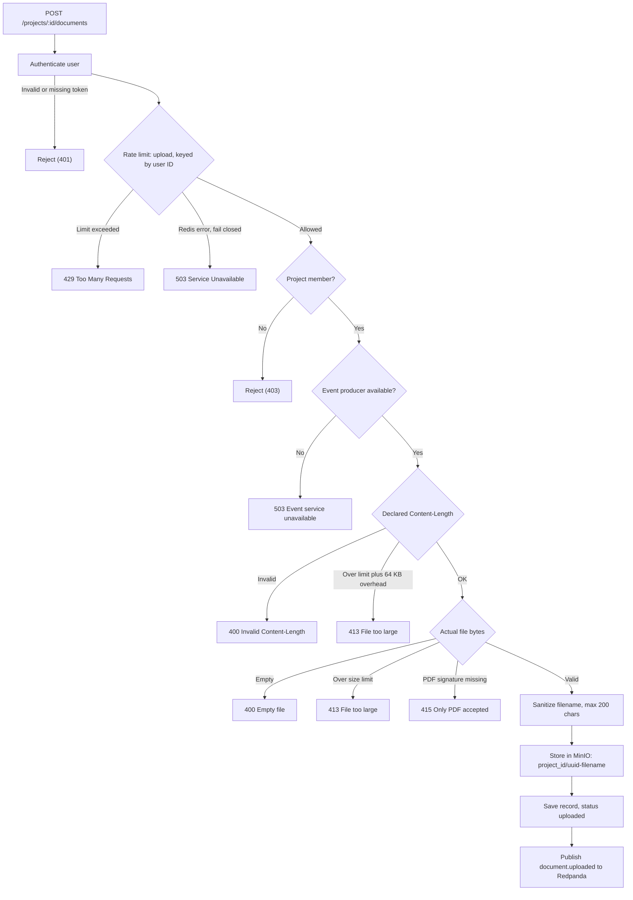

# AtlasOps

Self-hosted document intelligence platform. Upload PDFs, organize them into projects and organizations, and search across your documents using natural language with semantic embeddings and ranked results.

## Features

- **Auth & multi-tenancy** — Sign up, log in, create organizations and projects. JWT access tokens (argon2-hashed passwords). Rate-limited auth endpoints.
- **PDF upload** — Files stored in MinIO/S3 (separate from the text index). 25 MB default limit. Status tracking: `uploaded` → `indexed` → `error`.
- **Semantic search** — Embedding-based vector search with pgvector (IVFFlat index). Returns ranked passages with similarity scores. Works with local SentenceTransformer embeddings by default; optional LLM/embedding provider configuration.
- **Background ingestion** — After upload, a `document.uploaded` event is published to Redpanda/Kafka. A worker consumes it, extracts text (pypdf), chunks it, generates embeddings, and upserts into pgvector — no blocking the upload flow.
- **Web UI** — Next.js 16 client app: demo mode (no account required), signed-in workspace with org/project switcher, upload form with status polling, and semantic search results.
- **API** — FastAPI backend with OpenAPI docs at `/docs`.

## Architecture

```
┌─────────────┐     ┌─────────────┐     ┌──────────────┐     ┌──────────┐
│   Web UI    │────▶│    API      │────▶│   Postgres   │     │  MinIO   │
│   (Next.js) │     │  (FastAPI)  │     │   (pgvector) │     │  (S3)    │
└─────────────┘     └─────────────┘     └──────────────┘     └──────────┘
        │               │                   ▲              ▲
        │               │ stores PDFs       │ stores chunks│
        │               └──────────────────▶│ + embeddings │
        ▼                                   │              │
     ┌─────────────┐            │            │              │
     │   Redpanda  │────────────┘            │              │
     │  (Kafka)    │                         │              │
     └─────────────┘                         │              │
           ▲                                 │              │
           │ consumes                        │              │
           │                                 │              │
     ┌─────────────┐                         │              │
     │   Worker    │─────────────────────────┴──────────────┘
     │ (consumer)  │     reads PDFs from MinIO
     └─────────────┘
```

- **Document files** live in MinIO buckets — the API writes uploads there; the worker reads them back for text extraction. MinIO is separate from the pgvector text index.
- **Embeddings** are generated locally via `sentence-transformers` (all-MiniLM-L6-v2, 384-dim), pre-downloaded at image build time so the worker doesn't need network on first run.
- **Rate limiting** via `slowapi` + Redis for login, register, upload, and search endpoints.

## Prerequisites

- Docker + Docker Compose
- ~4 GB RAM available for containers
- Ports 5432, 6379, 9000, 9001, 19092, 8001, 3000 free on localhost

## Quick Start

### 1. Clone and configure

```bash
cd /path/to/atlasops
cp .env.example .env
```

Review `.env` and change the defaults — especially `JWT_SECRET`, `POSTGRES_PASSWORD`, `S3_SECRET_KEY`, and `S3_ACCESS_KEY`. `JWT_SECRET` must be at least 32 random characters.

### 2. Start the stack

```bash
docker compose up -d --build
```

This builds the `api`, `worker`, and `web` images and starts postgres, redis, minio, redpanda, api, worker, and web.

### 3. Verify

```bash
# API health
curl http://localhost:8001/health

# Web UI
http://localhost:3000
```

All services should report `Up` or `Healthy` in `docker compose ps`.

### 4. First user

Register through the web UI at `http://localhost:3000` or via the API:

```bash
curl -X POST http://localhost:8001/auth/register \
  -H "Content-Type: application/json" \
  -d '{"email":"you@example.com","password":"Str0ng!Passw0rd","organization_name":"My Org"}'
```

Password minimum: 12 characters.

## API Reference

Base URL: `http://localhost:8001` (mapped from container port 8000)

### Auth
| Method | Endpoint | Description |
|--------|----------|-------------|
| `POST` | `/auth/register` | Create account + organization (requires `ALLOW_REGISTRATION=true`) |
| `POST` | `/auth/login` | Get JWT access token |

Register response includes `access_token`, `token_type`, `user`, and `organizations`. Use the token as `Authorization: Bearer <token>`.

### Organizations & Projects
| Method | Endpoint | Description |
|--------|----------|-------------|
| `GET` | `/organizations` | List user's organizations (Bearer auth) |
| `POST` | `/organizations` | Create an organization |
| `GET` | `/organizations/{org_id}/projects` | List projects in an organization |
| `POST` | `/organizations/{org_id}/projects` | Create a project |

### Documents
| Method | Endpoint | Description |
|--------|----------|-------------|
| `POST` | `/projects/{project_id}/documents` | Upload a PDF (multipart `file` field) |
| `GET` | `/projects/{project_id}/documents` | List documents with `status` and `is_indexed` |

Upload response: `{"id": "...", "filename": "...", "size_bytes": ..., "status": "uploaded", "is_indexed": false}`.

### Search
| Method | Endpoint | Description |
|--------|----------|-------------|
| `POST` | `/projects/{project_id}/search` | Semantic search: `{"query": "...", "limit": 10}` |

Search response: array of `{chunk_id, document_id, filename, chunk_index, text, similarity_score}`.

OpenAPI docs: `http://localhost:8001/docs`

## Environment Variables

| Variable | Default | Description |
|----------|---------|-------------|
| `JWT_SECRET` | *(required)* | Signing secret for JWT access tokens (32+ random chars) |
| `POSTGRES_DB` | `atlasops` | Database name |
| `POSTGRES_USER` | `atlasops` | Database user |
| `POSTGRES_PASSWORD` | *(required)* | Database password |
| `DATABASE_URL` | *(derived)* | Full PostgreSQL connection string |
| `REDIS_URL` | `redis://localhost:6379` (host dev) / `redis://redis:6379` (inside Compose) | Rate-limit storage |
| `S3_ENDPOINT` | `http://localhost:9000` | MinIO endpoint |
| `S3_BUCKET` | `atlasops-documents` | Bucket for document files |
| `S3_ACCESS_KEY` | `minioadmin` | MinIO access key |
| `S3_SECRET_KEY` | *(required)* | MinIO secret key |
| `KAFKA_BROKERS` / `REDPANDA_BOOTSTRAP` | `localhost:19092` | Kafka bootstrap for ingestion events |
| `ALLOW_REGISTRATION` | `true` | Allow public sign-up |
| `MAX_UPLOAD_MB` | `25` | Max PDF upload size |
| `RATE_LIMIT_LOGIN` | `10/minute` | Login rate limit |
| `RATE_LIMIT_REGISTER` | `5/hour` | Registration rate limit |
| `RATE_LIMIT_UPLOAD` | `10/minute` | Upload rate limit |
| `RATE_LIMIT_SEARCH` | `30/minute` | Search rate limit |

## Development

### Backend tests

```bash
cd /path/to/atlasops
./venv/bin/pip install -r apps/api/requirements.txt
./venv/bin/python -m pytest apps/api/tests
```

### Frontend lint & build

```bash
cd apps/web
npm ci
npm run lint
npm run build
```

## Production Notes

- Change all default passwords/secrets in `.env` before deploying.
- `JWT_SECRET` must be strong and unique — rotating it invalidates all existing sessions.
- Consider placing a reverse proxy (nginx, traefik, caddy) in front of the API and web containers with TLS. Behind a proxy, rate limiting falls back to the proxy IP unless you forward `X-Forwarded-For`; configure your proxy to pass it through.
- MinIO data persists in the `minio-data` volume; postgres data in `postgres-data`. Back these up regularly.
- MinIO image source: upstream `minio/minio` was archived in October 2025 and removed from Docker Hub in September 2026. This project uses `pgsty/minio`, a maintained community fork, pinned to digest `sha256:b6bfe7239bfc83fb90d31612d9704d86039dd714f7904b3f1ad68f211e602372` for fresh-installs and supply-chain integrity.
- The worker restarts automatically (`restart: unless-stopped` in compose).
- For closed registrations, set `ALLOW_REGISTRATION=false`.

## Security controls

Upload request path, traced from `apps/api/main.py`, `ratelimit.py`, and `uploads.py`:



- **Rate limits:** registration, login, upload, and search each have a separate limit. The key is the user ID from a valid token, otherwise the client IP. Over the limit returns 429. If Redis or the limiter's storage fails, the request returns 503 and does not go through.
- **Upload validation:** the declared Content-Length is checked first to reject early. The received file's real size, emptiness, and PDF signature are then checked. The default limit is 25 MB, set with `MAX_UPLOAD_MB`.
- **Storage:** files are stored under a random UUID, and filenames are sanitized and capped at 200 characters.
- **Known limits:** the PDF signature check filters file type and does not scan for malware. Requests with no Content-Length are size-checked only after the body is received.

## Project Structure

```
atlasops/
├── compose.yaml                  # Docker Compose service definitions
├── .env                          # Environment variables (create from template)
├── docker-entrypoint.sh          # Ensures pgvector extension + IVFFlat index at startup
├── .dockerignore                 # Build context exclusions
├── apps/
│   ├── api/
│   │   ├── Dockerfile            # CPU-only torch + pre-downloaded embedding model
│   │   ├── main.py               # FastAPI app: auth, projects, documents, search
│   │   ├── auth.py               # JWT, argon2 password hashing
│   │   ├── database.py           # SQLAlchemy engine + pgvector setup
│   │   ├── storage.py            # MinIO/S3 object storage
│   │   ├── uploads.py            # PDF validation + size limits
│   │   ├── consumer.py           # Kafka consumer: extract, chunk, embed, upsert
│   │   ├── ratelimit.py          # slowapi rate limiting
│   │   ├── requirements.txt      # Python dependencies
│   │   ├── migrations/           # SQL migrations (pgvector, auth tables)
│   │   └── tests/                # Pytest suite (31 tests)
│   └── web/
│       ├── Dockerfile            # Next.js 16 production build
│       ├── app/page.tsx          # Demo + signed-in workspace UI
│       ├── package.json
│       └── postcss.config.mjs    # Tailwind CSS v4
├── examples/
│   └── sample-documents/         # Sample PDF for testing
└── docs/                         # ADR, architecture, operations, security docs
```

## License

MIT — see [LICENSE](LICENSE).
