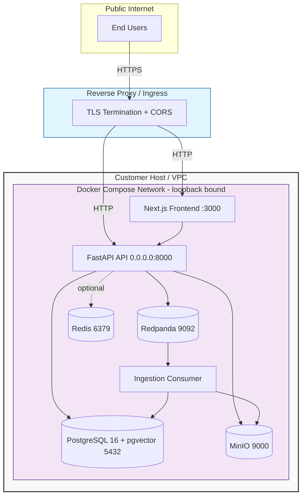

# AtlasOps Deployment Topology

## Port Bindings (Default)

| Service | Port | Binding |
|---------|------|---------|
| FastAPI API | 8000 | localhost only (via reverse proxy) |
| Next.js Frontend | 3000 | localhost only |
| PostgreSQL | 5432 | localhost only (Docker network) |
| MinIO | 9000 | localhost only (Docker network) |
| Redpanda | 9092 | localhost only (Docker network) |
| Redis | 6379 | localhost only (Docker network) |

All service-to-service communication occurs over the Docker Compose internal network, not exposed to the public internet. The reverse proxy is the only ingress point and terminates TLS.
