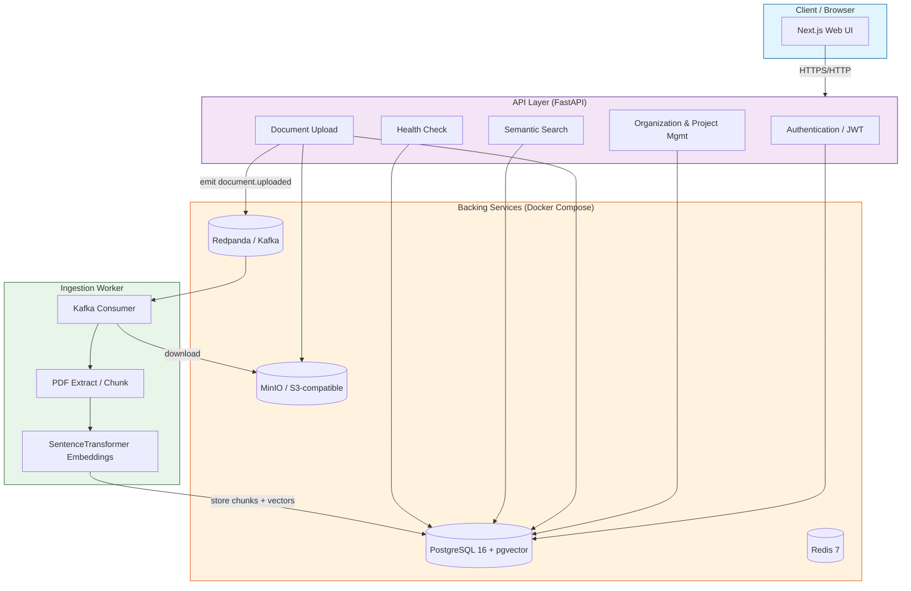

# AtlasOps System Architecture

## Overview

Mermaid diagrams for the AtlasOps system architecture, data flows, and deployment topology.

## Component Responsibilities

| Component | Responsibility |
|-----------|----------------|
| Next.js Web UI | Client interface for auth, project/docs management, search |
| FastAPI API | Auth, org/project CRUD, document upload, semantic search, health |
| PostgreSQL + pgvector | Organizations, projects, documents, chunks, embeddings, vector search |
| MinIO | PDF object storage (S3-compatible) |
| Redpanda | Event streaming for document.uploaded (decouples upload from indexing) |
| Redis | Rate-limit storage (optional; memory:// default) |
| Ingestion Worker | Consumes upload events, extracts/chunks/embeds PDFs, writes to DB |
